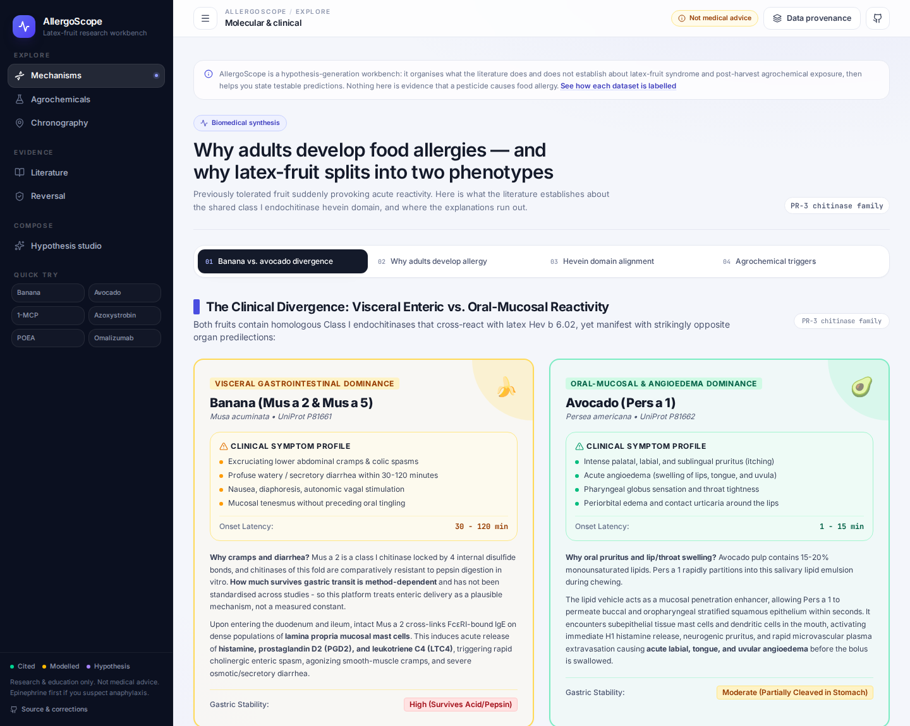

# AllergoScope

**A research workbench for latex-fruit syndrome and the question of whether post-harvest
agrochemical handling is changing the allergenic load of the fruit we eat.**

🔗 Live: https://jpalmer95.github.io/allergoscope/



AllergoScope exists because adult-onset food allergy is common and badly explained. Roughly
half of food-allergic US adults developed their allergy as adults (Gupta et al., *JAMA Netw
Open* 2019). Latex-fruit syndrome — cross-reactivity between natural rubber latex and
banana, avocado, chestnut, kiwi and others — is one of the best-characterised mechanisms we
have for adult-acquired fruit reactivity. It is mediated by **class I chitinases carrying the
43-residue hevein domain**, not by class II chitinases (Blanco 1999; Díaz-Perales 1998;
Posch 1999; Wagner & Breiteneder 2002).

The open question this project tracks is narrower and more interesting than "pesticides are
bad": *does post-harvest handling — ripening-gas inhibitors, fungicide dips, wax coatings —
change how much of that chitinase reaches your mouth, and does any of that shift explain part
of the observed rise?* Nobody has published the measurement that would answer it. This site is
built to make that measurement obvious, cheap and worth doing.

## What it does

| Section | Purpose |
| --- | --- |
| **Molecular & Clinical Mechanisms** | Hevein-domain cross-reactivity, allergen-by-allergen protein records, and why oral vs enteric phenotypes differ |
| **Agrochemical & Food Cross-Reference** | Registered post-harvest agents, their barrier / PR-protein hypotheses, regulatory history |
| **Chronographical Map & Lag Analytics** | Drag a lag window across 1990–2026 and watch how a cross-correlation behaves (on illustrative series — see honesty note) |
| **Reversal & Desensitisation** | What the trials actually showed: OUtMATCH, omalizumab-facilitated multi-OIT, dupilumab in EoE, microbiome and nanoparticle work |
| **PubMed Literature Scout** | Live NCBI E-utilities search plus a curated set of verified landmark papers |
| **Hypothesis Studio** | Compose a food × exposure × symptom brief, separated into *established / plausible / untested*, ending in falsifiable predictions |

## Honesty rules (please keep them)

This is a mixed-provenance dataset and the UI labels every part of it:

- **Cited** — traces to a PMID/DOI verified against NCBI E-utilities.
- **Modelled estimate** — hand-set index or multiplier used to rank hypotheses. Not a measurement.
- **Hypothesis** — a mechanistic story that is plausible but untested.

Specifically: the chronographical indices (agrochemical usage, search volume, incidence) are
hand-curated example values, not FAOSTAT / USGS / Google Trends / claims data. The Pearson *r*
shown is computed on those values — it demonstrates the lagged-correlation method, it is **not**
an epidemiological finding. The "+X% chitinase induction" figures per agrochemical are modelled
placeholders. Ethylene treatment is documented to *induce* class I chitinases (Sánchez-Monge et
al., *JACI* 2000), which means an ethylene blocker such as 1-MCP could plausibly *lower*
chitinase content rather than raise it — a direction the literature has not settled and this
project therefore refuses to assert.

Never add a citation without checking that the PMID/DOI resolves to the paper you mean. An
earlier draft of this dataset carried six plausible-looking citations of which five pointed at
unrelated papers; that failure mode is the single biggest risk to a project like this.

## Design system

- One palette in `src/index.css` (`@theme`): graphite neutrals, cobalt accent, softer shadows.
- Primitives instead of one-off classes: `.card`, `.card-sunk`, `.card-lift`, `.chip`, `.btn`,
  `.eyebrow`, `.num`, plus `.status-cited / -modelled / -hypothesis` for the provenance tiers.
- Self-hosted Inter (UI) and JetBrains Mono (identifiers, indices) — latin-subset variable fonts,
  no external font requests.
- App shell in `src/components/Shell.tsx` (rail, top bar, mobile drawer); page headers and the
  provenance panel in `src/components/Chrome.tsx`.
- Deep links: `#/mechanism`, `#/agrochemicals`, `#/chronography`, `#/literature`, `#/reversal`,
  `#/hypothesis`.

## Run it locally

```bash
npm install
npm run dev          # http://localhost:3000  (Express + Vite middleware)
```

Optional: `GEMINI_API_KEY` in `.env` layers a language model on top of the rule engine for the
Hypothesis Studio. Without it the deterministic rule engine answers — which is what the public
site runs.

```bash
npm run build        # static build to dist/
npm run preview      # serve the built site
npm test             # unit tests (allergy-math)
npm run lint         # tsc --noEmit
```

## Deploy

The public site is a static build on **GitHub Pages**, published by
`.github/workflows/deploy.yml` on every push to `main`. PubMed and PubChem are called directly
from the browser (both send `Access-Control-Allow-Origin: *`), so there is no backend to host.
`npm run dev` still runs the Express server for local work.

`GITHUB_PAGES=true` switches Vite's `base` to `/<repo>/`; anything else builds at `/` for a
custom domain or self-hosted deploy.

## Contributing

See [CONTRIBUTING.md](CONTRIBUTING.md). The most useful contributions, in order:

1. A citation that is wrong, missing, or overstated.
2. A measurement that would falsify a claim on the site.
3. Real data to replace a modelled series.
4. A symptom / exposure observation you are willing to describe generally.

## Not medical advice

AllergoScope is a research and education tool. It does not diagnose, does not estimate your
personal risk, and is not a substitute for an allergist with component-resolved diagnostics
(rMus a 2, rPers a 1, rHev b 6.02). If you suspect anaphylaxis: epinephrine first, emergency
services second, internet third.

## License

Apache-2.0. See [LICENSE](LICENSE).
